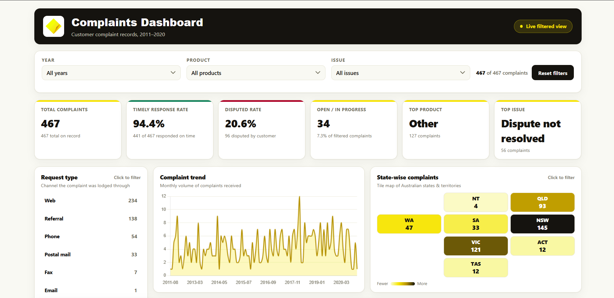
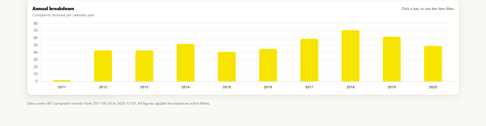

# CommBank Complaints Dashboard

An interactive, single-file HTML dashboard for exploring 467 customer complaint records (2011–2020). Every filter and chart click cross-filters all panels, and the KPIs recompute live.

**[▶ Live demo](https://junaidazhar42.github.io/commbank-complaints-dashboard.html/)**




## Business question

Which channels, states, products and issues drive complaints, how has volume changed over time, and how well are complaints being handled (timely response and disputes)?

## Features

- **Six live KPI cards** that recompute from the current filter selection
- **Cross-filtering everywhere:** dropdown filters (Year, Product, Issue) plus clickable Request type bars, state map tiles and annual bars
- **Removable filter chips** and a one-click reset
- **Request type** bar list, **monthly complaint trend** line chart, **state-wise tile map** and **annual breakdown** bar chart, following a hand-drawn wireframe
- **Responsive** layout down to mobile widths
- **Accessible:** labelled controls, full keyboard support, `aria-pressed` states, WCAG AA contrast
- **Fully self-contained:** one HTML file, data and Chart.js embedded, no network calls

## KPIs

| KPI | Definition |
|---|---|
| Total complaints | Count of records in the current filter |
| Timely response rate | % of records where `Timely response = Yes` |
| Disputed rate | % of records where `Consumer disputed = Yes` |
| Open / in progress | Count of records where `Status = In progress` |
| Top product | Most frequent `Product` in the current filter |
| Top issue | Most frequent `Issue` in the current filter |

## Dataset

467 complaint records with these fields: complaint ID, date received, year, product, sub-product, issue, request type, state, postcode, company response, timely response, consumer disputed, and status. The source spreadsheet contained blank padding rows beyond the 467 real records; these were removed.

## Assumptions

- "Request type" is interpreted as the **channel** through which the complaint was lodged (Web, Referral, Phone, Postal mail, Fax, Email).
- The **complaint trend** is plotted monthly from `Date received`; the **annual breakdown** aggregates the same data by calendar year.
- The state map is a **tile-grid** (not true geographic boundaries) arranged to loosely mirror Australia's geography.
- No data was invented or imputed.

## Tech stack

- Vanilla JavaScript, HTML, CSS (no frameworks, no build step)
- [Chart.js](https://www.chartjs.org/) 4.4.4 (MIT licence), inlined in the file

## Run locally

Download `commbank_complaints_dashboard.html` and open it in any modern browser. No server or installation needed.

## Repository structure

```
├── commbank_complaints_dashboard.html        # the complete dashboard
├── README.md
├── dashboard_image1.png
├── dashboard_image2.png
└── commbank_complaints_data.xlsx
```

## Design

The palette is built around the logo: yellow `#FFD800`, near-black ink `#15130F` and warm off-white, with the map's colour ramp running from pale yellow to ink.

## Disclaimer

This is an independent portfolio project created for learning and demonstration purposes. It is not affiliated with, endorsed by, or representing the Commonwealth Bank of Australia. The CommBank name and logo are trademarks of their respective owner.
